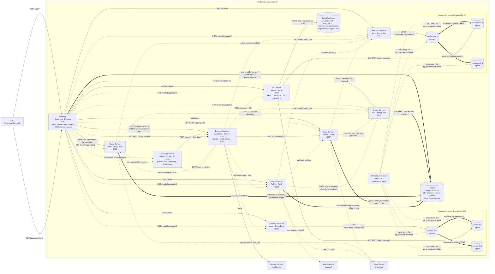
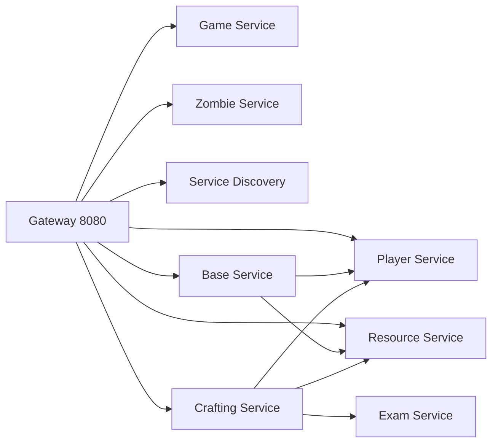

# Architecture




- Solid arrows: implemented calls. Dotted arrows from game/base/crafting: service-to-service calls that are mocked inside the service for now (they log `[MOCK ...]`).
- **Lab 5, forgotten components:** the gateway's aggregated `GET /health`, the mocked **Exam Service**, and the mocked calls of Base (World, Player) and Crafting (Player, Exam, World, Base) were implemented in earlier labs but missing from the diagram.
- Lab 3: every service registers with the Service Discovery on startup (`POST /register`) and every 10 s (heartbeat); the Service Discovery polls their `/status` and posts alerts to Discord. The gateway balances over the registered instances (round robin) and removes an instance after 3 failures within `UPSTREAM_TIMEOUT_MS * 3.5`.
- Lab 4: the **Message Broker** (queues with publish / receive / ack, redelivery, dead-letter queue) runs next to the Service Discovery and registers with it. `GET /logs` on the gateway downloads the logs of the whole system (Service Discovery, broker and every registered instance).
- zombie-service and resource-service run 3 replicas each (state in PostgreSQL); the in-memory services run one instance.
- Only the gateway publishes a port to the host (plus 8761 and 8090 for the demo); services and databases are reachable only inside the compose network.
- Database per service: zombie-service and resource-service each own a PostgreSQL **cluster**.
- The Game Service validates JWTs issued by the Player Service with the shared `JWT_SECRET`.
- **Lab 5 – Cache:** one **Redis** (`cache`) inside the network. The gateway caches the GET answers of the scaled zombie/resource services and deletes them on every write through it. Player and Game share the authentication cache (`auth:token:<sha256>`, `auth:revoked:<sha256>`). Player caches profiles, Base and Crafting their most-read GETs and token lookups. If Redis is down, every component works without it.
- **Lab 5 – Replication + failover:** each cluster has 1 primary + 2 streaming replicas (`postgres-ha` image). The **DB Failover monitor** promotes the most up-to-date replica when a primary misses 3 checks; the other replica follows the new primary and the old primary rejoins as a replica (a node that finds a newer primary stops itself, so there is never a split brain). The services list all three nodes in their JDBC URL with `targetServerType=primary`, so they find the new primary on their own. The primary/replica labels in the diagram are the initial roles.
- **Lab 5 – Data Warehouse + ETL:** the **ETL Service** reads the zombie types/behaviours and the resource points from a replica (`target_session_attrs=prefer-standby`, so the players' primary is not loaded), cleans and enriches them (one spelling per id, danger score, fill ratio) and loads them into the **Data Warehouse** (`warehouse-db`): dimensions `dim_zombie_type`, `dim_room`, `dim_resource`, snapshot facts `fact_zombie_snapshot`, `fact_resource_snapshot`, report views, and an `etl_runs` log. Reports: `GET /api/warehouse/summary`, `/api/warehouse/resources/<resource>`, `/api/warehouse/etl/runs`.


# Gateway

The single point of entry of the system. Clients (Postman, a frontend) talk **only** to the gateway on
port **8080**; it forwards each request to the right microservice and streams the answer back.
Node.js 22 + Express 5, written in JavaScript.

## Why a gateway?

- **One address for clients.** They don't need to know that players live on 8081 and games on 8082,
  or that services move, split or scale.
- **Services stay private.** In Docker Compose only the gateway publishes a port; the Java services
  are reachable only inside the compose network.
- **One place for cross-cutting concerns:** request ids, logging, timeouts, health, uniform errors,
  and since lab 3 **load balancing** and a **circuit breaker**.

## Run

```bash
npm install
npm start            # http://localhost:8080
npm test             # 20 tests, Node's built-in runner, uses fake services (no Java needed)

# Docker
docker build -t gateway .
docker run -p 8080:8080 -e PLAYER_SERVICE_URL=http://host.docker.internal:8081 \
  -e GAME_SERVICE_URL=http://host.docker.internal:8082 gateway
```

| Env variable | Default | Meaning |
|---|---|---|
| `PORT` | 8080 | port the gateway listens on |
| `PLAYER_SERVICE_URL` | http://localhost:8081 | where the Player Service lives (`http://player-service:8081` in compose) |
| `GAME_SERVICE_URL` | http://localhost:8082 | where the Game Service lives (`http://game-service:8082` in compose) |
| `ZOMBIE_SERVICE_URL` | http://localhost:8083 | Zombie Service (`http://zombie-service:8081` in compose) |
| `RESOURCE_SERVICE_URL` | http://localhost:8084 | Resource Service (`http://resource-service:8082` in compose) |
| `BASE_SERVICE_URL` | http://localhost:5007 | Base Service (`http://base-service:5007` in compose) |
| `CRAFTING_SERVICE_URL` | http://localhost:5008 | Crafting Service (`http://crafting-service:5008` in compose) |
| `EXAM_SERVICE_URL` | http://localhost:5009 | Exam Service (`http://exam-service:5009` in compose) |
| `UPSTREAM_TIMEOUT_MS` | 10000 | after this, the gateway answers 504 (the "task timeout limit") |
| `SERVICE_DISCOVERY_URL` | – | lab 3: where the Service Discovery lives (`http://service-discovery:8761` in compose). When set, the `*_SERVICE_URL` variables are ignored |
| `SELF_URL` | – | the gateway's own address, so it can register itself too (`http://gateway:8080`)

## Routing table (`src/config.js`)

| Path prefix | Service |
|---|---|
| `/api/players/**`, `/api/trades/**` | player-service |
| `/api/game/**`, `/api/lobbies/**`, `/api/sessions/**` | game-service |
| `/api/zombies/**` | zombie-service |
| `/api/resources/**` | resource-service |
| `/api/bases/**` | base-service |
| `/api/crafting/**` | crafting-service |
| `/api/exams/**` | exam-service |

The path, query string, method, headers (including `Authorization`) and body are forwarded unchanged,
so every endpoint from the service READMEs works through the gateway, e.g.
`POST http://localhost:8080/api/players/login`.

## Architecture diagram



**Base Service** owns base state per player, barricades, facilities, upgrades, and Kiki state.
It depends on the **Resource Service** (spend resources) and the **Player Service** (grant Kiki rewards),
and is reached through the **Gateway** at `/api/bases/**`.

**Crafting Service** owns recipe definitions, craft operations, and recipe availability rules.
It depends on the **Resource Service** (consume resources), the **Player Service** (grant crafted items),
and the **Exam Service** (recipe unlocks), and is reached through the **Gateway** at `/api/crafting/**`.

## Gateway's own endpoints

| Method | Path | Response |
|---|---|---|
| GET | `/` | name + routing table |
| GET | `/health` | `200` if all services are UP, `503` otherwise: `{"status":"UP","gateway":"UP","services":{"player-service":"UP", ...},"instances":{"zombie-service":[{"instance_id":"...","status":"UP"}, ...]}}`. Every instance is asked; a service is UP if at least one instance is. Spring Boot services are asked on `/actuator/health`, Flask services on `/health` (`healthPath` in the routing table) |
| GET | `/status` | lab 3: `requests_total`, the instances it balances over, the round-robin counters and the circuit breaker (`max_failures`, `window_ms`, `trips`) |

## Errors produced by the gateway

Same shape as the services: `{ "error": "CODE", "message": "..." }`.

| Status | `error` | When |
|---|---|---|
| 404 | `ROUTE_NOT_FOUND` | no service handles that path |
| 503 | `NO_INSTANCE_AVAILABLE` | no instance of that service is registered |
| 502 | `SERVICE_UNAVAILABLE` | the service is down / unreachable |
| 504 | `GATEWAY_TIMEOUT` | the service did not answer within `UPSTREAM_TIMEOUT_MS` |

Errors from a service (401, 404, 409 ...) are passed through untouched.

## Lab 3: scaling up

**Where are the services? (grade 5)** With `SERVICE_DISCOVERY_URL` set, `src/registry.js` downloads
`GET /services` from the Service Discovery every 3 s. An instance started with
`docker compose up -d --scale zombie-service=4 --no-recreate` registers itself and gets requests a
few seconds later; a stopped one disappears the same way (log lines `Instance joined` /
`Instance left`).

**Round robin (grade 6).** `src/loadBalancer.js` keeps one counter per service: with instances
`[A, B, C]` requests go A, B, C, A, B, C ... (`counter % number of instances`). Every answer carries
`X-Instance-Id`, so you can see it in Postman or with `curl -i`.

**Circuit breaker (grade 7).** `src/circuitBreaker.js` counts failures **per instance, over all its
endpoints**: unreachable (502), timeout (504) or a 5xx answer. 4xx answers are not failures (the
service works, the request was wrong). **3 failures within `UPSTREAM_TIMEOUT_MS * 3.5`** (35 s by
default) trip it, and the trip is logged:

```
ERROR [gateway] CIRCUIT BREAKER TRIPPED for zombie-service/zombie-2: 3 failures within 35000 ms
```

The gateway is the only component that calls other services (the calls between game/base/crafting
and other services are still mocks), so this is where the breaker lives.

**Try it** (with `python run.py docker` running):

```bash
for i in 1 2 3 4 5 6; do curl -s -o /dev/null -D - localhost:8080/api/zombies/types | grep -i x-instance-id; done
docker kill pad-lab_2-zombie-service-2                      # crash one instance
for i in 1 2 3 4 5 6 7 8 9; do curl -s -o /dev/null -w "%{http_code} " localhost:8080/api/zombies/types; done
docker compose logs gateway | grep TRIPPED                  # every 3rd request was a 502
curl localhost:8080/status                                  # circuit_breaker.trips
```

About 30 s later the Service Discovery stops listing the dead instance (no heartbeats), and the
gateway stops sending it requests.

## Code tour

Read them in this order (about 500 lines in total):

1. `src/server.js` – starts the gateway (`npm start`), the registry refresh and the self-registration.
2. `src/config.js` – environment variables and the **routing table** (prefix → service).
3. `src/app.js` – the Express app: raw body → request id + log → `GET /`, `GET /health`, `GET /status` → one proxy per route → 404.
4. `src/proxy.js` – picks an instance (round robin), forwards one request with the built-in `fetch()`,
   copies the answer back. No instance → 503, instance down → 502, too slow → 504; failures go to the circuit breaker.
5. `src/registry.js` – which instances exist (from the Service Discovery, or fixed URLs without one).
6. `src/loadBalancer.js` – round robin (20 lines).
7. `src/circuitBreaker.js` – 3 failures in the window → log (40 lines).
8. `src/health.js` – asks every instance's health path in parallel.
9. `src/register.js` – registers the gateway itself with the Service Discovery.
10. `src/log.js` – one log line with time, level and `[gateway]`.

`test/gateway.test.js` (10 tests) checks the forwarding with fixed URLs; `test/scaling.test.js`
(10 tests) uses a fake Service Discovery and three fake instances for round robin, instances
joining/leaving and the circuit breaker.

Response headers added: `X-Request-Id` (follow one request through all logs), `X-Served-By`
(which service answered) and `X-Instance-Id` (which instance of it).

## Contributing

- Branches: `main` (releases) and `development` (integration), both protected; work on
  `feature/<issue>-short-name` or `fix/<issue>-short-name` and open a PR into `development`.
- Every PR uses `.github/pull_request_template.md` and must pass the **CI** workflow
  (`.github/workflows/ci.yml`: `npm test` + Docker build) and get the agreed number of approvals.
- Releasing: tag `vX.Y.Z` on `main` → CI pushes `<user>/gateway:X.Y.Z` and `:latest` to Docker Hub
  (needs the `DOCKERHUB_USERNAME` and `DOCKERHUB_TOKEN` repository secrets).

## Design choice: simple over clever

The proxy reads the whole request body, then calls the service with `fetch()`, then reads the whole
answer and sends it back. That's easy to read and debug, and fine for small JSON requests like ours
(body limit 1 MB). A production gateway would **stream** the bytes instead of holding them in memory
(e.g. with the `http-proxy-middleware` library), but the behaviour seen by the client is the same.
